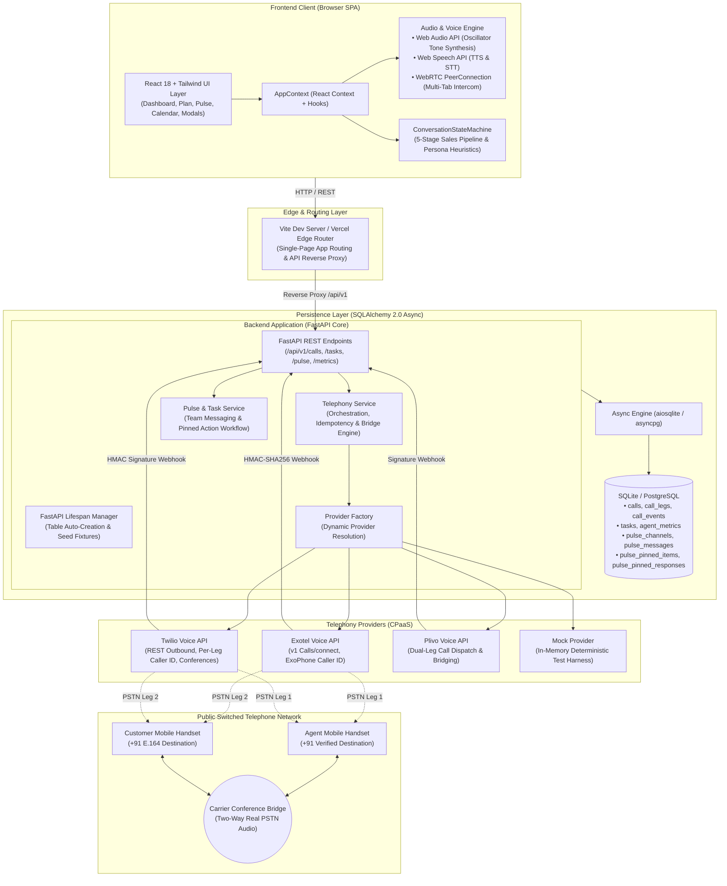
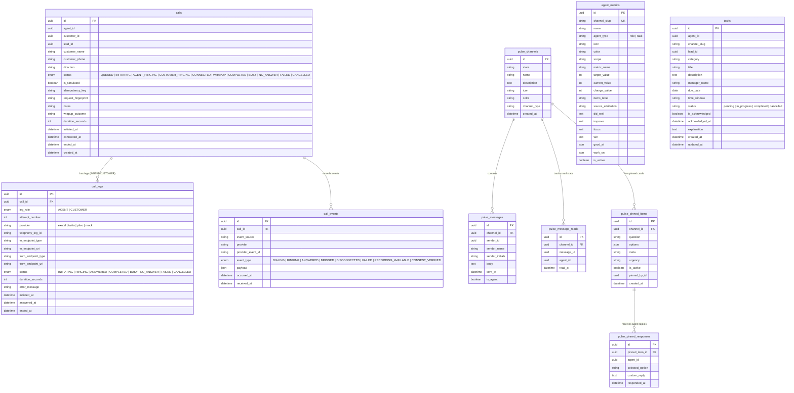
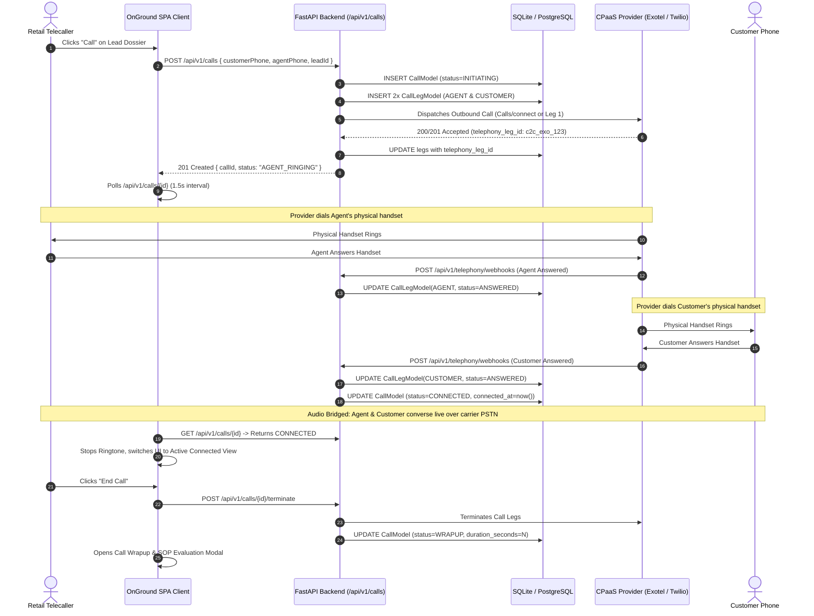

# OnGround CallCentre OS (`oncall`)

> **Enterprise-Grade Retail Telecalling Platform & Multi-Provider PSTN Telephony Suite**  
> Tailored for retail telecalling agents at **The Sleep Company (Koramangala Store)** for the **On-Ground.ai Engineering Hire Assignment (November 2026)**.

Repository: [github.com/Aldrinsui/oncall](https://github.com/Aldrinsui/oncall)  
Stack: **React 18**, **TypeScript (Strict Mode)**, **Vite**, **Tailwind CSS 3.4**, **FastAPI**, **SQLAlchemy 2.0 (Async)**, **SQLite / PostgreSQL**, **Exotel**, **Twilio**, **Plivo**, **WebRTC**, **Web Audio API**, **Web Speech API**.

---

## 📑 Table of Contents

1. [Executive Summary](#-executive-summary)
2. [System Architecture Diagram](#-system-architecture-diagram)
3. [Database Architecture & Entity-Relationship (ER) Diagram](#-database-architecture--entity-relationship-er-diagram)
4. [Telephony & CPaaS Provider Architecture](#-telephony--cpaas-provider-architecture)
5. [AI Voice Roleplay & Practice Calling Engine](#-ai-voice-roleplay--practice-calling-engine)
6. [DPDP Compliance & Minor Guard Engine](#-dpdp-compliance--minor-guard-engine)
7. [Multi-Tab WebRTC Intercom](#-multi-tab-webrtc-intercom)
8. [Shift Management & Operational Features](#-shift-management--operational-features)
9. [REST API Reference](#-rest-api-reference)
10. [Local Development & Setup Guide](#-local-development--setup-guide)
11. [Verification & Automated Test Suite](#-verification--automated-test-suite)
12. [Production Deployment Guide](#-production-deployment-guide)

---

## 🏛 Executive Summary

**OnGround CallCentre OS** is an end-to-end telecalling system engineered for omnichannel mattress and ergonomic furniture retail. It unifies:

- **Physical PSTN Calling**: Multi-carrier abstraction orchestrating dual-leg outbound calling, handset pickups, and conference bridging across **Exotel**, **Twilio**, and **Plivo**.
- **AI Voice Practice Simulator**: Real-time browser-based voice simulation powered by the Web Audio and Web Speech APIs, enabling agents to practice objection handling with AI customer personas offline or online without consuming carrier credits.
- **Regulatory DPDP Compliance**: Native compliance with India's Digital Personal Data Protection (DPDP) Act, providing multilingual verbal voice consent scripts (Kannada, Hindi, English), WhatsApp verification, and strict guardian consent gating for minors.
- **Operational Shift Hub**: A real-time dashboard featuring prioritized lead queues, dynamic SOP scoring, 7-day performance metrics, team messaging via Pulse, and calendar coaching schedules.

---

## 📐 System Architecture Diagram



---

## 🗄 Database Architecture & Entity-Relationship (ER) Diagram

The persistence layer is structured using **SQLAlchemy 2.0 Async Declarative Mapping** with strict foreign keys, cascading deletions, UUID primary keys, and JSON event ledgers.



---

## 📞 Telephony & CPaaS Provider Architecture

### 1. Unified Telephony Provider Interface
Every telephony provider implements the canonical `TelephonyProvider` interface ([`backend/app/domains/telephony/provider_interface.py`](file:///Users/aldrinjerry/Downloads/oncall/backend/app/domains/telephony/provider_interface.py)):

```python
class TelephonyProvider(Protocol):
    async def initiate_leg(self, request: LegDialRequest) -> LegDialResult: ...
    async def terminate_leg(self, telephony_leg_id: str) -> None: ...
    async def bridge_legs(self, request: BridgeRequest) -> BridgeResult: ...
    async def parse_webhook(self, payload: bytes, headers: dict) -> TelephonyEvent: ...
    async def verify_webhook_signature(self, payload: bytes, headers: dict) -> bool: ...
```

### 2. Multi-Provider Capabilities Matrix

| Feature | Exotel | Twilio | Plivo | Mock Provider |
|---|---|---|---|---|
| **API Contract** | v1 `Calls/connect` API | REST v2010 Outbound Calls | v1 Outbound Call API | In-Memory Async State Machine |
| **Authentication** | HTTP Basic Auth (`API_KEY:API_TOKEN`) | HTTP Basic Auth (`SID:AUTH_TOKEN` or `API_KEY:SECRET`) | HTTP Basic Auth (`AUTH_ID:AUTH_TOKEN`) | Dummy In-Memory Auth |
| **Call Orchestration** | Single `Calls/connect` POST with `CallType=trans` connecting Agent & Customer | Dual-Leg dispatch with Conference Room Bridging | Dual-Leg dispatch with Multi-Party Conference | Virtual Instant Ringing & Connection |
| **Caller ID Support** | Configured `EXOTEL_CALLER_ID` (ExoPhone) | Dedicated per-leg caller IDs (`TWILIO_AGENT_CALLER_ID`, `TWILIO_CUSTOMER_CALLER_ID`) | Configured `PLIVO_CALLER_ID` | Virtual Caller IDs |
| **Webhook Security** | HMAC-SHA256 signature verification | Cryptographic Auth Token / HMAC validation | Cryptographic Signature validation | Always Valid |
| **Handset Bridge Verification** | Correlates callbacks via `CustomField` | Enforces both physical handsets answered before bridge | Enforces both legs answered before bridge | Simulated Handset Pickups |

### 3. Outbound 2-Leg Call Sequence Diagram



---

## 🎙 AI Voice Roleplay & Practice Calling Engine

The assignment requires demonstrating a **working calling feature** beyond mock screens. To allow continuous agent training without carrier charges or sandbox limitations, the app includes a dedicated **AI Voice Roleplay Simulator**:

```
                       ┌───────────────────────────────────────────┐
                       │          Active Calling Engine            │
                       └─────────────────────┬─────────────────────┘
                                             │
               ┌─────────────────────────────┴─────────────────────────────┐
               ▼                                                           ▼
┌──────────────────────────────────────────┐               ┌──────────────────────────────────────────┐
│   Pure AI Customer Simulation (Roleplay) │               │       Carrier Outbound PSTN Calling      │
├──────────────────────────────────────────┤               ├──────────────────────────────────────────┤
│ • startRoleplay(target)                  │               │ • startCall(target)                      │
│ • Local Web Audio Dual-Tone Synthesis    │               │ • Dispatches POST /api/v1/calls          │
│ • Web SpeechSynthesis (Customer Voice)   │               │ • Real carrier PSTN to mobile handsets   │
│ • Live Web SpeechRecognition (Agent STT) │               │ • Status polling & conference bridge     │
│ • Zero backend network calls             │               │ • Terminate call via CPaaS REST API      │
│ • Offline-resilient & persistent         │               │ • Full webhook state machine updates     │
└──────────────────────────────────────────┘               └──────────────────────────────────────────┘
```

### 1. Dual-Path Architecture Separation
To ensure stability, `startRoleplay` and `startCall` are strictly separated in [`AppContext.tsx`](file:///Users/aldrinjerry/Downloads/oncall/src/context/AppContext.tsx):
- **`startRoleplay(target)`**: Sets `callMode = 'ROLEPLAY'`, resets consent, plays local Web Audio ringing, and transitions to dialogue without calling the backend. Even if the backend server is stopped, AI practice remains 100% operational.
- **`startCall(target)`**: Sets `callMode = 'PSTN'`, formats phone numbers to E.164 (`+91`), initiates real provider dispatch, and polls call status.

### 2. Audio & Speech Technologies
- **Web Audio Ringtone Synthesis ([`src/services/audioService.ts`](file:///Users/aldrinjerry/Downloads/oncall/src/services/audioService.ts))**: Mathematical sine-wave dual oscillators (`440Hz + 480Hz`) with gain envelopes generating authentic telephone ringing (2.0s burst / 4.0s pause) with zero external audio assets.
- **Web SpeechSynthesis (TTS)**: Synthesizes persona dialogue aloud, prioritizing `en-IN` (Indian English) voices with room acoustic decay cooldowns (500ms) to prevent acoustic feedback into the microphone.
- **Web SpeechRecognition (STT)**: Transcribes the agent's live voice into streaming transcript lines in real time, automatically aborting speech capture while the AI customer is speaking to eliminate speaker-to-mic echo leaks.

### 3. Conversation State Machine & Personas ([`src/services/conversationEngine.ts`](file:///Users/aldrinjerry/Downloads/oncall/src/services/conversationEngine.ts))
Implements a 5-stage sales state machine with automatic stage progression:
1. **Stage 1: Greeting & Intent Confirmation**: Agent introduces themselves and confirms interest in SmartGRID products.
2. **Stage 2: Needs Discovery**: Explores sleeping posture, firmness preferences, and orthopedic pain points.
3. **Stage 3: SmartGRID Pitch**: Explains patented grid structure, temperature neutrality, and spine alignment.
4. **Stage 4: Objection Handling (EMI & Warranty)**: Explains 12-month zero-cost EMI plans, 10-year warranty, and 100-night home trial.
5. **Stage 5: Closing & Showroom Demo**: Secures Koramangala store showroom firm-test visit and shares official quote.

**Pre-Configured Retail Personas**:
- **Mukunda R. (Ortho GRID Persona)**: Chronic lower back stiffness, seeks orthopedic recommendation, price-sensitive regarding upfront cost.
- **Rohan P. (Luxe King Persona)**: Partner motion isolation concerns, memory foam heat trapping complaints.
- **Suresh Nair (Budget & Trial Persona)**: Skeptical about online mattress purchases, requests 100-night trial details.
- **Priya Sharma (Inbound Warranty Inquiry)**: Expresses concerns regarding firmness and showroom test timing.

---

## 🛡 DPDP Compliance & Minor Guard Engine

Built to conform with the **Digital Personal Data Protection (DPDP) Act, 2023**:

1. **Multilingual Verbal Consent**: Provides localized audio consent prompts in **Kannada (ಕನ್ನಡ)**, **Hindi (हिन्दी)**, and **English**:
   - *Kannada*: "ಈ ಕಾಲ್ ಅನ್ನು ರೆಕಾರ್ಡ್ ಮಾಡಬಹುದಾ? ಇದು ನಿಮ್ಮ ಸರ್ವೀಸ್ ಮತ್ತು ಫಾಲೋ-ಅಪ್‌ಗೆ ಮಾತ್ರ..."
   - *Hindi*: "क्या हम यह कॉल रिकॉर्ड कर सकते हैं? सिर्फ़ आपकी सर्विस और फ़ॉಲೋ-अप के लिए है..."
   - *English*: "Can we record this call? Only for your service and follow-up..."
2. **WhatsApp Consent Channel Alternative**: Agents can trigger a WhatsApp consent confirmation link if verbal consent cannot be captured.
3. **Minor Guard Enforcement**: If the customer is identified as a minor, the system enforces strict gating requiring parent/guardian consent with a separate mobile number.
4. **Media Capture Gate**: Microphone audio streams and SpeechRecognition STT are strictly suspended while consent status is `pending` or `declined`. Recording only activates once consent is explicitly `granted`.

---

## 🌐 Multi-Tab WebRTC Intercom

Enables authentic two-way human audio communication across two browser tabs or windows without an external signaling server:
- Uses `BroadcastChannel('onground-callcentre-peer')` for local signaling (SDP offer/answer exchange and ICE candidates).
- Media streams are piped to an HTML `<audio autoplay />` element so two retail agents can rehearse peer-to-peer audio calls across tabs.
- Includes incoming call offer popovers and hardware-level track mute controls.

---

## 💼 Shift Management & Operational Features

### 1. Shift Dashboard & Real-Time KPIs
- **Shift Progress Tracker**: Tracks calls made vs shift target (`14/18` calls completed).
- **OG Score Gauge**: Radial benchmark score (`76`) computed across 4 pillars: Script Adherence (30%), Customer Sentiment (25%), Objection Handling (25%), and Follow-Up Speed (20%).
- **Interactive 7-Day Performance Chart**: SVG Recharts visualizer with metric toggles for Calls Made (`134`), Avg Talk Time (`72.6m`), and Conversions (`37`).
- **Live Queue**: Real-time incoming callback list with priority tags and one-click dial buttons.

### 2. Today's Calling Plan (Strict Scoring & Ranking)
- **Calls to Make**: 6 prospective leads strictly ranked by attractiveness score in descending order (`90 -> 88 -> 85 -> 78 -> 72 -> 65`), complete with pagination, ICP fit scores (`87%`), Intent scores (`91%`), collapsible buying signals, and direct **Practise with AI** buttons.
- **Incoming Calls**: Missed customer inquiries tracking aggregate value at stake (`₹77,390`) with individual "Call Back" CTAs.
- **Recent Calls & Post-Call SOP Audit**: Complete history logs with 6-pillar SOP audit scores, recording consent statuses, and verbatim transcript evidence quotes.

### 3. Pulse Team Messaging & Avani Copilot
- **Channel Messaging**: Real-time team channels (`#callcentre-team`, `#leads-koramangala`, `#announcements`, `#kudos-board`).
- **Interactive Pinned Items**: Interactive action cards allowing agents to submit shift confirmations and schedule adjustments directly into the chat stream.
- **Avani AI Copilot**: Context-aware assistant providing live pitch guidance, store product specifications, and instant practice session routing.

---

## 🔌 REST API Reference

The backend exposes an interactive OpenAPI Swagger UI at `http://localhost:8000/docs`.

### Telephony Endpoints (`/api/v1/calls`)
| Method | Endpoint | Description |
|---|---|---|
| `POST` | `/api/v1/calls` | Initiates an outbound PSTN call session across both agent and customer legs. |
| `GET` | `/api/v1/calls/{id}` | Fetches real-time call status, leg statuses, and duration. |
| `POST` | `/api/v1/calls/{id}/bridge` | Bridges confirmed agent and customer call legs into conference. |
| `POST` | `/api/v1/calls/{id}/terminate` | Terminates active call legs via provider CPaaS API. |
| `POST` | `/api/v1/calls/{id}/cancel` | Cancels in-flight call session before connection. |
| `POST` | `/api/v1/telephony/webhooks/{provider}` | Webhook listener for Exotel, Twilio, and Plivo carrier status callbacks. |

### Pulse & Task Endpoints
| Method | Endpoint | Description |
|---|---|---|
| `GET` | `/api/v1/pulse/channels` | Retrieves all store communication channels. |
| `GET` | `/api/v1/pulse/channels/{id}/messages` | Fetches message history for a channel. |
| `POST` | `/api/v1/pulse/channels/{id}/messages` | Sends a message into a channel thread. |
| `POST` | `/api/v1/pulse/channels/{id}/pinned/{itemId}/respond` | Submits an interactive response to a pinned action card. |
| `GET` | `/api/v1/pulse/metrics` | Fetches agent metrics and performance benchmarks. |
| `GET` | `/api/v1/tasks` | Lists daily shift tasks with lead associations. |
| `PATCH` | `/api/v1/tasks/{id}/ack` | Acknowledges or completes a shift task. |

---

## 🚀 Local Development & Setup Guide

### Prerequisites
- **Node.js**: `v18.x` or `v20.x`
- **Python**: `3.11+` (tested up to `3.14.2`)
- **Browser**: Google Chrome recommended for native Web Speech API support.

### 1. Clone & Install Dependencies
```bash
# Clone the repository
git clone https://github.com/Aldrinsui/oncall.git
cd oncall

# Install frontend dependencies
npm install

# Setup Python virtual environment
python3 -m venv .venv
source .venv/bin/activate
pip install -r backend/requirements.txt
```

### 2. Configure Environment Variables
Create a `.env` file in the project root:
```env
# Telephony Provider Selection: "exotel", "twilio", "plivo", or "mock"
TELEPHONY_PROVIDER=exotel

# Exotel Credentials
EXOTEL_ACCOUNT_SID=your_exotel_account_sid
EXOTEL_API_KEY=your_exotel_api_key
EXOTEL_API_TOKEN=your_exotel_api_token
EXOTEL_API_BASE_URL=https://api.exotel.com
EXOTEL_CALLER_ID=+9180XXXXXXXX

# Twilio Credentials (Optional fallback)
TWILIO_ACCOUNT_SID=your_twilio_account_sid
TWILIO_AUTH_TOKEN=your_twilio_auth_token
TWILIO_CALLER_ID=+9180XXXXXXXX
TWILIO_AGENT_CALLER_ID=+9180XXXXXXXX
TWILIO_CUSTOMER_CALLER_ID=+9180XXXXXXXX

# General Telephony Configuration
PUBLIC_WEBHOOK_URL=https://your-domain.ngrok-free.app
DEV_AGENT_PHONE=+919XXXXXXXXX
DEV_AGENT_ID=00000000-0000-0000-0000-000000000001
ENVIRONMENT=development

# Database Configuration
DATABASE_URL=sqlite+aiosqlite:///./oncall.db
```

### 3. Initialize Database Tables
```bash
PYTHONPATH=. .venv/bin/python -c "
import asyncio
from backend.app.core.database import Base, async_engine
import backend.app.models.telephony
import backend.app.models.pulse
import backend.app.models.tasks

async def init():
    async with async_engine.begin() as conn:
        await conn.run_sync(Base.metadata.create_all)
asyncio.run(init())
"
```

### 4. Run Development Servers
```bash
# Terminal 1: Start FastAPI Backend Server
PYTHONPATH=. .venv/bin/uvicorn backend.app.main:app --reload --port 8000

# Terminal 2: Start Vite Frontend Server
npm run dev
```

Visit `http://localhost:5173` to access the application.

---

## 🧪 Verification & Automated Test Suite

The codebase maintains full automated test coverage across both frontend and backend suites.

### Frontend Test Suite (Vitest)
```bash
npm test -- --run
```
- **13 Test Suites**, **175 Unit & Integration Tests**:
  - `roleplayPstnSeparation.test.tsx`: Verifies strict isolation between AI roleplay and PSTN calling, ensuring practice calls never fail or dismiss unexpectedly.
  - `callRingingLifecycle.test.tsx`: Validates Web Audio dual-tone ringing, answer transitions, reject/decline handling, and audio teardown.
  - `callUiIsolation.test.tsx`: Verifies persistent calling layer mounting and layout isolation across navigation views.
  - `consentEngine.test.ts`: Tests DPDP multilingual verbal consent, WhatsApp verification, and minor protection gating.
  - `leadsModal.test.tsx`: Verifies lead dossier display, ICP/Intent metrics, pagination, and keyboard shortcuts.
  - `pstnDialerAndApiConfig.test.tsx`: Tests E.164 phone formatting, dual-tone key feedback, and provider error reporting.
  - `pulseFeature.test.ts`: Tests channel messaging, pinned card responses, and Avani copilot grounding.

### Frontend Production Build
```bash
npm run build
# Executes TypeScript compilation (tsc -b) and Vite bundle optimization
```

### Backend Test Suite (Pytest)
```bash
PYTHONPATH=. .venv/bin/pytest backend/tests/ -v
```
- **110 Backend Tests**:
  - `test_provider_http_mocking.py`: Comprehensive HTTP mocking for **Exotel**, **Twilio**, and **Plivo**, testing outbound calling contracts, webhook signature verifications, 401 auth failures, and leg bridging.
  - `test_pstn_outbound_calling.py`: Validates FastAPI call creation endpoints, idempotency key deduplication, E.164 validation, and status polling.
  - `test_call_state_machine.py`: Tests call session status transitions (`QUEUED` -> `CUSTOMER_RINGING` -> `CONNECTED` -> `COMPLETED`).
  - `test_domain_entities.py`: Validates SQLAlchemy models, cascade deletions, and relationship mappings.
  - `test_openapi_parity.py`: Asserts REST endpoint contract parity with OpenAPI schemas.

---

## 🚢 Production Deployment Guide

### Frontend Deployment (Vercel)
The repository includes a production-ready [`vercel.json`](file:///Users/aldrinjerry/Downloads/oncall/vercel.json) configured for Single-Page Application routing:
- Set `VITE_BACKEND_API_URL` to your production backend URL (e.g., `https://api.yourdomain.com`).
- Deploy via Vercel CLI:
  ```bash
  vercel --prod
  ```

### Backend Deployment (Docker / Linux VM)
1. Run Uvicorn behind a production reverse proxy (Nginx or Caddy) with SSL termination:
   ```bash
   gunicorn -w 4 -k uvicorn.workers.UvicornWorker backend.app.main:app --bind 0.0.0.0:8000
   ```
2. Expose a public HTTPS webhook endpoint (e.g. via Cloudflare Tunnel or AWS ALB) and configure `PUBLIC_WEBHOOK_URL` so carrier callbacks from Exotel/Twilio can reach `/api/v1/telephony/webhooks/{provider}`.

---

## 👥 Contributors & Attributions

Developed for the **On-Ground.ai Engineering Hire Assignment (November 2026)**.  
Built with **Google DeepMind Antigravity** agentic pair programming environment powered by **Claude** and **Gemini** models.
