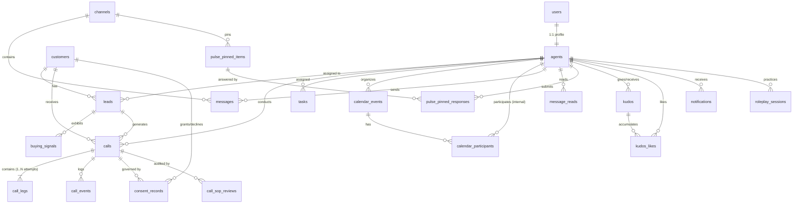

# OnGround.ai — Final Master Architecture Specification
**Status: FINALIZED & FROZEN — Approved for Phase 1 Sign-Off**
**Target: FastAPI + PostgreSQL Modular Monolith with Provider-Independent Telephony**

> [!IMPORTANT]
> This is the definitive, frozen master engineering specification for OnGround.ai. It incorporates all 7 remaining corrections and 3 design improvements from the senior engineering review. No project source code files have been modified. Implementation begins upon Phase 1 contract freeze.

---

## 1. Verified Baseline & Scope Boundaries

### 1a. Test & Compilation Baseline (Invariant Requirement)
The existing frontend test suite is our invariant baseline and **must remain 100% passing across all phases**:
| Verification Command | Baseline Result | Requirement |
|---|---|---|
| `npx tsc --noEmit` | ✅ 0 errors | Must remain 0 errors |
| `vitest run` | ✅ 73/73 passing (6 suites) | Zero regressions permitted |
| `vite build` | ✅ Clean bundle | Zero production build warnings/errors |

### 1b. Architectural Guardrails
1. **Repository Layout**: The React application stays at the repository root (`src/`, `package.json`, `vite.config.ts`). The backend lives under `backend/` at root. The frontend will **never** be moved into a subdirectory.
2. **PSTN / Telephony**: Plivo is evaluated provisionally. **No vendor SDK (`pip install plivo`), XML endpoints, or real PSTN calls will be introduced.** The system depends exclusively on `base.py` (abstract interface), `mock.py` (simulated adapter), and `pstn_placeholder.py` (unconfigured boundary). Inbound PSTN is explicitly deferred.
3. **No Unnecessary Rewrites**: Working React components, Web Audio sound generators, Web Speech synthesis/recognition, and WebRTC loopback channels are preserved.

---

## 2. Settled Architectural Decisions

### A. Authentication Strategy: Development Identity First
* **Decision**: Do not build a custom production JWT/password authentication system yet.
* **Identity Model**: A proper `users` table is established. `agents.user_id` is a 1:1 foreign key to `users.id`.
* **Auth Boundary**: FastAPI injects an authenticated identity via a dependency `get_current_agent()`.
  * **Development Mode (`ENVIRONMENT=development`)**: Yields the seeded default agent profile (`Arvind Rajan`). Alternatively accepts header `X-Dev-Agent-Id: <uuid>`.
  * **Production Mode (`ENVIRONMENT=production`)**: Requests lacking a valid Bearer token return `401 Unauthorized`. Development bypass is completely disabled.

### B. Real-Time Delivery: 2-Second Short Polling
* **Decision**: Active call status updates will use **short polling at a 2-second interval**.
* **Lifecycle Separation**:
  1. **Active Polling Phase**: Polls `GET /api/v1/calls/{id}` every 2,000 ms during progression (`INITIATING`, `AGENT_RINGING`, `CUSTOMER_RINGING`, `CONNECTED`, `ON_HOLD`).
  2. **Polling Cessation at `WRAPUP`**: When the call disconnects and enters `WRAPUP`, active polling stops immediately. The UI displays the post-call wrap-up form.
  3. **Terminal Business Finalization**: The agent completes documentation and clicks "Submit Wrap-up" (`POST /api/v1/calls/{id}/wrapup`). The backend transitions the call to `COMPLETED` and returns the final record.
  4. **Immediate Terminal States**: If a call fails before connecting (`FAILED`, `BUSY`, `NO_ANSWER`, `CANCELLED`), polling stops immediately and displays the failure reason.
  5. **Overlap Prevention & Retry**: Polling uses chained `setTimeout` after response resolution (never `setInterval`). Up to 3 consecutive network failures trigger exponential backoff (2s → 4s → 8s) before alerting the user.

### C. Database Seeding: Idempotent JSON Fixture Importer
* **Mechanism**:
  1. `package.json` provides `npm run export:seeds` which executes a Node script (`tsx scripts/export-seeds.ts`) that imports `src/data/mockData.ts` via TypeScript runtime and exports validated JSON into `backend/fixtures/seed_data.json`.
  2. A pre-built, schema-validated `backend/fixtures/seed_data.json` is committed into the repository.
  3. `backend/scripts/seed.py` loads the JSON fixtures, parses them via Pydantic schemas, and performs idempotent upserts using deterministic UUID v5 keys. Running repeatedly creates no duplicates.
  4. Arvind Rajan and Koramangala store are strictly development fixtures.

### D. Architectural Layering: Separation of Models & DTOs
Public API responses will **not** mirror database tables 1:1. The architecture separates three distinct layers:
1. **SQLAlchemy Persistence Models** (`backend/app/domains/*/models.py`): Define database tables, foreign keys, constraints, and indexes. Internal columns (`request_fingerprint`, `is_simulated`) live here.
2. **Domain Entities** (`backend/app/domains/*/entities.py`): Pure dataclasses/enums representing business logic and state machine validation, decoupled from ORM.
3. **Pydantic API DTOs** (`backend/app/domains/*/schemas.py`): Explicit Request and Response schemas. Internal database columns are stripped from public responses.

---

## 3. Complete Domain Entity Inventory (22 Entities, 22 Tables)

| # | Entity | Domain | Database Table | Description |
|---|---|---|---|---|
| 1 | `User` | Identity | `users` | Core user identity, role, and email |
| 2 | `Agent` | Identity | `agents` | Tele-caller agent profile, store, device endpoint, OG score |
| 3 | `Customer` | CRM | `customers` | Phone identity, brand-scoped unique customer record |
| 4 | `Lead` | CRM | `leads` | Outbound sales prospect, scores, EMI notes, priority |
| 5 | `BuyingSignal` | CRM | `buying_signals` | Customer intent signals (e.g. "Browsed Ortho 3x") |
| 6 | `Call` | Telephony | `calls` | Parent call session, overall status, timing, notes |
| 7 | `CallLeg` | Telephony | `call_legs` | Discrete provider legs (Agent/Customer) with attempt tracking |
| 8 | `CallEvent` | Telephony | `call_events` | Immutable audit log of lifecycle events and webhook receipts |
| 9 | `ConsentRecord` | Compliance | `consent_records` | DPDP Act audio recording consent audit trail |
| 10 | `CallSopReview` | Compliance | `call_sop_reviews` | Checklist review of pitch, warranty, closing, and score |
| 11 | `RoleplaySession`| Training | `roleplay_sessions` | Practice call sessions, persona, score, and turn transcripts |
| 12 | `Task` | Productivity | `tasks` | Shift daily task list with 5-state lifecycle |
| 13 | `CalendarEvent` | Scheduling | `calendar_events` | Team meetings, coaching sessions, unique session slug |
| 14 | `CalendarParticipant`| Scheduling | `calendar_participants`| Invited internal agents and external collaborators |
| 15 | `Channel` | Collaboration | `channels` | Team discussion channels & role feeds |
| 16 | `Message` | Collaboration | `messages` | Channel chat messages with authentic agent sender FK |
| 17 | `MessageRead` | Collaboration | `message_reads` | Per-agent read receipts for dynamic unread count calculation |
| 18 | `PulsePinnedItem`| Collaboration | `pulse_pinned_items` | Pinned action cards requiring team input |
| 19 | `PulsePinnedResponse`| Collaboration | `pulse_pinned_responses`| Persistent agent responses to pinned cards |
| 20 | `Kudos` | Engagement | `kudos` | Peer recognition posts |
| 21 | `KudosLike` | Engagement | `kudos_likes` | Granular agent likes on kudos posts |
| 22 | `Notification` | System | `notifications` | Actionable system notifications with CTA links |

---

## 4. Final Entity-Relationship (ER) Diagram



---

## 5. Corrected PostgreSQL Schema (DDL — Exactly 22 Tables)

```sql
-- Extensions
CREATE EXTENSION IF NOT EXISTS "uuid-ossp";
CREATE EXTENSION IF NOT EXISTS "pgcrypto";

-- ============================================================================
-- 1. ENUMS
-- ============================================================================
CREATE TYPE user_role AS ENUM ('AGENT', 'MANAGER', 'ADMIN');

CREATE TYPE call_status AS ENUM (
  'QUEUED',           -- In queue, dial request pending
  'INITIATING',       -- Backend issued dial request to telephony provider
  'AGENT_RINGING',    -- Leg 1 ringing on agent's device
  'CUSTOMER_RINGING', -- Leg 2 ringing on customer phone
  'CONNECTED',        -- Both legs bridged and active
  'ON_HOLD',          -- Call placed on hold
  'WRAPUP',           -- Disconnected; agent completing documentation
  'COMPLETED',        -- Wrap-up submitted, record finalized
  'FAILED',           -- Dial or bridge failure
  'BUSY',             -- Destination line reported busy
  'NO_ANSWER',        -- Ring timeout expired without pickup
  'CANCELLED'         -- Aborted prior to bridge
);

CREATE TYPE call_leg_role AS ENUM ('AGENT', 'CUSTOMER');

CREATE TYPE call_leg_status AS ENUM (
  'INITIATING',
  'RINGING',
  'ANSWERED',
  'COMPLETED',
  'FAILED',
  'BUSY',
  'NO_ANSWER',
  'CANCELLED'
);

CREATE TYPE call_event_type AS ENUM (
  'CALL_CREATED',
  'LEG_INITIATING',
  'LEG_RINGING',
  'LEG_ANSWERED',
  'CALL_CONNECTED',
  'CALL_ON_HOLD',
  'CALL_RESUMED',
  'LEG_TERMINATED',
  'CALL_WRAPUP_STARTED',
  'CALL_COMPLETED',
  'CALL_FAILED',
  'CALL_BUSY',
  'CALL_NO_ANSWER',
  'CALL_CANCELLED'
);

CREATE TYPE task_status AS ENUM (
  'PENDING', 'IN_PROGRESS', 'BLOCKED', 'COMPLETED', 'CANCELLED'
);

CREATE TYPE consent_state AS ENUM ('PENDING', 'GRANTED', 'DECLINED');
CREATE TYPE consent_method AS ENUM ('VOICE', 'WHATSAPP', 'SMS');

CREATE TYPE participant_status AS ENUM ('INVITED', 'ACCEPTED', 'DECLINED', 'TENTATIVE');

CREATE TYPE notification_action AS ENUM (
  'OPEN_PULSE_CHANNEL',
  'OPEN_INCOMING_CALLS',
  'OPEN_COACH',
  'VIEW_SCORE',
  'VIEW_RANK'
);

-- ============================================================================
-- 2. IDENTITY DOMAIN (TABLES 1 & 2)
-- ============================================================================
CREATE TABLE users (
  id          UUID PRIMARY KEY DEFAULT gen_random_uuid(),
  email       TEXT NOT NULL UNIQUE,
  full_name   TEXT NOT NULL,
  role        user_role NOT NULL DEFAULT 'AGENT',
  is_active   BOOLEAN NOT NULL DEFAULT TRUE,
  created_at  TIMESTAMPTZ NOT NULL DEFAULT now(),
  updated_at  TIMESTAMPTZ NOT NULL DEFAULT now()
);

CREATE TABLE agents (
  id             UUID PRIMARY KEY DEFAULT gen_random_uuid(),
  user_id        UUID NOT NULL UNIQUE REFERENCES users(id) ON DELETE CASCADE,
  initials       TEXT NOT NULL,
  emoji          TEXT NOT NULL DEFAULT '🦸‍♂️',
  store          TEXT NOT NULL,
  brand          TEXT NOT NULL,
  -- Nullable real phone; no fabricated default numbers
  phone_e164     TEXT,
  endpoint_type  TEXT NOT NULL DEFAULT 'WEBRTC_MOCK' CHECK (endpoint_type IN ('WEBRTC_MOCK', 'SIP_URI', 'PSTN_PHONE')),
  endpoint_uri   TEXT NOT NULL DEFAULT 'webrtc:agent-dev',
  og_score       INTEGER NOT NULL DEFAULT 0 CHECK (og_score BETWEEN 0 AND 100),
  rank           INTEGER NOT NULL DEFAULT 1,
  created_at     TIMESTAMPTZ NOT NULL DEFAULT now(),
  updated_at     TIMESTAMPTZ NOT NULL DEFAULT now(),
  -- Ensure PSTN phone is provided if endpoint_type is PSTN_PHONE
  CONSTRAINT chk_agent_endpoint CHECK (
    (endpoint_type = 'PSTN_PHONE' AND phone_e164 IS NOT NULL) OR
    (endpoint_type != 'PSTN_PHONE')
  )
);

-- ============================================================================
-- 3. CRM DOMAIN: CUSTOMERS, LEADS, BUYING SIGNALS (TABLES 3, 4, 5)
-- ============================================================================
CREATE TABLE customers (
  id          UUID PRIMARY KEY DEFAULT gen_random_uuid(),
  name        TEXT NOT NULL,
  phone_e164  TEXT NOT NULL,
  brand       TEXT NOT NULL,
  created_at  TIMESTAMPTZ NOT NULL DEFAULT now(),
  updated_at  TIMESTAMPTZ NOT NULL DEFAULT now(),
  CONSTRAINT uq_customer_phone_brand UNIQUE (phone_e164, brand)
);
CREATE INDEX idx_customers_phone ON customers(phone_e164);

CREATE TABLE leads (
  id                   UUID PRIMARY KEY DEFAULT gen_random_uuid(),
  customer_id          UUID NOT NULL REFERENCES customers(id) ON DELETE RESTRICT,
  assigned_agent_id    UUID REFERENCES agents(id) ON DELETE SET NULL,
  interest             TEXT NOT NULL,
  product              TEXT NOT NULL,
  cross_sell           TEXT,
  emi_note             TEXT,
  notes                TEXT,
  attractiveness_score INTEGER NOT NULL DEFAULT 50 CHECK (attractiveness_score BETWEEN 0 AND 100),
  expected_value       NUMERIC(10, 2) NOT NULL DEFAULT 0.00 CHECK (expected_value >= 0),
  badge                TEXT NOT NULL DEFAULT 'Warm',
  badge_color          TEXT NOT NULL DEFAULT '#10b981',
  status_label         TEXT NOT NULL DEFAULT 'New Lead',
  icp_score            INTEGER NOT NULL DEFAULT 50 CHECK (icp_score BETWEEN 0 AND 100),
  intent_score         INTEGER NOT NULL DEFAULT 50 CHECK (intent_score BETWEEN 0 AND 100),
  source               TEXT NOT NULL DEFAULT 'Walk-in',
  last_contact_at      TIMESTAMPTZ,
  created_at           TIMESTAMPTZ NOT NULL DEFAULT now(),
  updated_at           TIMESTAMPTZ NOT NULL DEFAULT now()
);
CREATE INDEX idx_leads_agent ON leads(assigned_agent_id);
CREATE INDEX idx_leads_customer ON leads(customer_id);

CREATE TABLE buying_signals (
  id          UUID PRIMARY KEY DEFAULT gen_random_uuid(),
  lead_id     UUID NOT NULL REFERENCES leads(id) ON DELETE CASCADE,
  label       TEXT NOT NULL,
  detail      TEXT NOT NULL,
  icon        TEXT NOT NULL DEFAULT 'Sparkles',
  detected_at TIMESTAMPTZ NOT NULL DEFAULT now()
);
CREATE INDEX idx_buying_signals_lead ON buying_signals(lead_id);

-- ============================================================================
-- 4. TELEPHONY DOMAIN: CALLS, LEGS, EVENTS (TABLES 6, 7, 8)
-- ============================================================================
CREATE TABLE calls (
  id                  UUID PRIMARY KEY DEFAULT gen_random_uuid(),
  agent_id            UUID NOT NULL REFERENCES agents(id) ON DELETE RESTRICT,
  customer_id         UUID NOT NULL REFERENCES customers(id) ON DELETE RESTRICT,
  lead_id             UUID REFERENCES leads(id) ON DELETE SET NULL,
  direction           TEXT NOT NULL CHECK (direction IN ('OUTBOUND', 'INBOUND')),
  status              call_status NOT NULL DEFAULT 'QUEUED',
  is_simulated        BOOLEAN NOT NULL DEFAULT TRUE,
  idempotency_key     TEXT NOT NULL,
  request_fingerprint TEXT NOT NULL,                  -- SHA-256 hash of normalized request body
  notes               TEXT,
  wrapup_outcome      TEXT,
  created_at          TIMESTAMPTZ NOT NULL DEFAULT now(),
  initiated_at        TIMESTAMPTZ,
  connected_at        TIMESTAMPTZ,
  ended_at            TIMESTAMPTZ,
  -- Non-connected calls have strictly 0 duration; connected calls compute exact duration
  duration_seconds    INTEGER GENERATED ALWAYS AS (
    CASE 
      WHEN connected_at IS NOT NULL AND ended_at IS NOT NULL AND ended_at >= connected_at 
      THEN EXTRACT(EPOCH FROM (ended_at - connected_at))::INTEGER
      ELSE 0
    END
  ) STORED,
  -- Scope idempotency to the initiating agent
  CONSTRAINT uq_agent_idempotency UNIQUE (agent_id, idempotency_key),
  -- Non-negative duration guarantee
  CONSTRAINT chk_call_duration CHECK (duration_seconds >= 0),
  -- Robust chronology constraint: permits ended_at without connected_at for failed/unanswered calls
  CONSTRAINT chk_call_chronology CHECK (
    (initiated_at IS NULL OR initiated_at >= created_at) AND
    (connected_at IS NULL OR (initiated_at IS NOT NULL AND connected_at >= initiated_at)) AND
    (ended_at IS NULL OR (
      (connected_at IS NOT NULL AND ended_at >= connected_at) OR
      (connected_at IS NULL AND initiated_at IS NOT NULL AND ended_at >= initiated_at) OR
      (connected_at IS NULL AND initiated_at IS NULL AND ended_at >= created_at)
    ))
  )
);
CREATE INDEX idx_calls_agent_status ON calls(agent_id, status);
CREATE INDEX idx_calls_customer ON calls(customer_id);
CREATE INDEX idx_calls_created_at ON calls(created_at DESC);

CREATE TABLE call_legs (
  id                 UUID PRIMARY KEY DEFAULT gen_random_uuid(),
  call_id            UUID NOT NULL REFERENCES calls(id) ON DELETE CASCADE,
  leg_role           call_leg_role NOT NULL,
  attempt_number     INTEGER NOT NULL DEFAULT 1 CHECK (attempt_number >= 1),
  provider           TEXT NOT NULL DEFAULT 'mock',
  telephony_leg_id   TEXT,
  to_endpoint_type   TEXT NOT NULL CHECK (to_endpoint_type IN ('WEBRTC', 'SIP', 'PSTN')),
  to_endpoint_uri    TEXT NOT NULL,
  from_endpoint_type TEXT NOT NULL CHECK (from_endpoint_type IN ('WEBRTC', 'SIP', 'PSTN')),
  from_endpoint_uri  TEXT NOT NULL,
  status             call_leg_status NOT NULL DEFAULT 'INITIATING',
  initiated_at       TIMESTAMPTZ NOT NULL DEFAULT now(),
  answered_at        TIMESTAMPTZ,
  ended_at           TIMESTAMPTZ,
  duration_seconds   INTEGER GENERATED ALWAYS AS (
    CASE 
      WHEN answered_at IS NOT NULL AND ended_at IS NOT NULL AND ended_at >= answered_at
      THEN EXTRACT(EPOCH FROM (ended_at - answered_at))::INTEGER
      ELSE 0
    END
  ) STORED,
  error_message      TEXT,
  -- Supports retries/multiple attempts per role while ensuring clean leg uniqueness
  CONSTRAINT uq_call_leg_attempt UNIQUE (call_id, leg_role, attempt_number),
  CONSTRAINT chk_leg_duration CHECK (duration_seconds >= 0),
  -- Phone format validation enforced ONLY for PSTN endpoints
  CONSTRAINT chk_to_endpoint_pstn CHECK (
    (to_endpoint_type = 'PSTN' AND to_endpoint_uri ~ '^\+[1-9]\d{1,14}$') OR
    (to_endpoint_type != 'PSTN')
  ),
  CONSTRAINT chk_from_endpoint_pstn CHECK (
    (from_endpoint_type = 'PSTN' AND from_endpoint_uri ~ '^\+[1-9]\d{1,14}$') OR
    (from_endpoint_type != 'PSTN')
  ),
  -- Permits ended_at without answered_at for failed/unanswered legs
  CONSTRAINT chk_leg_chronology CHECK (
    (answered_at IS NULL OR answered_at >= initiated_at) AND
    (ended_at IS NULL OR (
      (answered_at IS NOT NULL AND ended_at >= answered_at) OR
      (answered_at IS NULL AND ended_at >= initiated_at)
    ))
  )
);
CREATE INDEX idx_call_legs_telephony ON call_legs(provider, telephony_leg_id);

CREATE TABLE call_events (
  id                UUID PRIMARY KEY DEFAULT gen_random_uuid(),
  call_id           UUID NOT NULL REFERENCES calls(id) ON DELETE CASCADE,
  event_source      TEXT NOT NULL DEFAULT 'MOCK',
  provider          TEXT NOT NULL DEFAULT 'mock',
  provider_event_id TEXT NOT NULL,
  event_type        call_event_type NOT NULL,
  payload           JSONB NOT NULL DEFAULT '{}'::jsonb,
  occurred_at       TIMESTAMPTZ NOT NULL,            -- Network/telephony event timestamp
  received_at       TIMESTAMPTZ NOT NULL DEFAULT now(), -- Backend ingestion timestamp
  -- Deduplication scoped to provider and event ID per call
  CONSTRAINT uq_call_provider_event UNIQUE (call_id, provider, provider_event_id)
);
CREATE INDEX idx_call_events_call ON call_events(call_id, occurred_at);

-- ============================================================================
-- 5. COMPLIANCE & TRAINING DOMAIN: CONSENT, SOP, ROLEPLAY (TABLES 9, 10, 11)
-- ============================================================================
CREATE TABLE consent_records (
  id               UUID PRIMARY KEY DEFAULT gen_random_uuid(),
  call_id          UUID NOT NULL REFERENCES calls(id) ON DELETE CASCADE,
  customer_id      UUID NOT NULL REFERENCES customers(id) ON DELETE RESTRICT,
  agent_id         UUID NOT NULL REFERENCES agents(id) ON DELETE RESTRICT,
  status           consent_state NOT NULL DEFAULT 'PENDING',
  method           consent_method NOT NULL DEFAULT 'VOICE',
  language         TEXT NOT NULL DEFAULT 'en-IN',
  verified_text    TEXT,                             -- Evidence text (nullable if pending/declined)
  is_minor         BOOLEAN NOT NULL DEFAULT FALSE,
  guardian_phone   TEXT,
  guardian_consent BOOLEAN,
  requested_at     TIMESTAMPTZ NOT NULL DEFAULT now(),
  consented_at     TIMESTAMPTZ,                      -- Nullable: populated ONLY when GRANTED
  -- Consent validity check constraint
  CONSTRAINT chk_consent_timestamp CHECK (
    (status = 'GRANTED' AND consented_at IS NOT NULL) OR
    (status != 'GRANTED' AND consented_at IS NULL)
  )
);
CREATE INDEX idx_consent_call ON consent_records(call_id);

CREATE TABLE call_sop_reviews (
  id          UUID PRIMARY KEY DEFAULT gen_random_uuid(),
  call_id     UUID NOT NULL REFERENCES calls(id) ON DELETE CASCADE,
  criterion   TEXT NOT NULL,
  passed      BOOLEAN NOT NULL DEFAULT FALSE,
  score       INTEGER NOT NULL DEFAULT 0 CHECK (score BETWEEN 0 AND 100),
  evidence    TEXT NOT NULL,
  reviewed_at TIMESTAMPTZ NOT NULL DEFAULT now()
);
CREATE INDEX idx_sop_reviews_call ON call_sop_reviews(call_id);

CREATE TABLE roleplay_sessions (
  id               UUID PRIMARY KEY DEFAULT gen_random_uuid(),
  agent_id         UUID NOT NULL REFERENCES agents(id) ON DELETE CASCADE,
  persona_id       TEXT NOT NULL,
  current_stage    TEXT NOT NULL DEFAULT 'greeting',
  score            INTEGER NOT NULL DEFAULT 0 CHECK (score BETWEEN 0 AND 100),
  turns_count      INTEGER NOT NULL DEFAULT 0,
  closing_goal_met BOOLEAN NOT NULL DEFAULT FALSE,
  transcript       JSONB NOT NULL DEFAULT '[]'::jsonb, -- Structured turns for coaching analysis
  started_at       TIMESTAMPTZ NOT NULL DEFAULT now(),
  completed_at     TIMESTAMPTZ,
  notes            TEXT
);
CREATE INDEX idx_roleplay_agent ON roleplay_sessions(agent_id);

-- ============================================================================
-- 6. PRODUCTIVITY DOMAIN: TASKS (TABLE 12)
-- ============================================================================
CREATE TABLE tasks (
  id          UUID PRIMARY KEY DEFAULT gen_random_uuid(),
  agent_id    UUID NOT NULL REFERENCES agents(id) ON DELETE CASCADE,
  lead_id     UUID REFERENCES leads(id) ON DELETE SET NULL,
  title       TEXT NOT NULL,
  status      task_status NOT NULL DEFAULT 'PENDING',
  due_date    DATE,
  created_at  TIMESTAMPTZ NOT NULL DEFAULT now(),
  updated_at  TIMESTAMPTZ NOT NULL DEFAULT now()
);
CREATE INDEX idx_tasks_agent_status ON tasks(agent_id, status);

-- ============================================================================
-- 7. SCHEDULING DOMAIN: CALENDAR & PARTICIPANTS (TABLES 13 & 14)
-- ============================================================================
CREATE TABLE calendar_events (
  id           UUID PRIMARY KEY DEFAULT gen_random_uuid(),
  organizer_id UUID NOT NULL REFERENCES agents(id) ON DELETE CASCADE,
  title        TEXT NOT NULL,
  location     TEXT,
  session_slug TEXT NOT NULL UNIQUE,                -- Enforces distinct session link slugs
  meta         TEXT,
  starts_at    TIMESTAMPTZ NOT NULL,
  ends_at      TIMESTAMPTZ NOT NULL,
  is_all_day   BOOLEAN NOT NULL DEFAULT FALSE,
  created_at   TIMESTAMPTZ NOT NULL DEFAULT now(),
  updated_at   TIMESTAMPTZ NOT NULL DEFAULT now(),
  CONSTRAINT chk_calendar_time CHECK (ends_at >= starts_at)
);
CREATE INDEX idx_calendar_starts ON calendar_events(starts_at);

CREATE TABLE calendar_participants (
  id               UUID PRIMARY KEY DEFAULT gen_random_uuid(),
  event_id         UUID NOT NULL REFERENCES calendar_events(id) ON DELETE CASCADE,
  is_agent         BOOLEAN NOT NULL DEFAULT FALSE,
  agent_id         UUID REFERENCES agents(id) ON DELETE SET NULL,
  name             TEXT NOT NULL,
  role             TEXT NOT NULL,
  email_or_channel TEXT NOT NULL,
  status           participant_status NOT NULL DEFAULT 'INVITED',
  invited_at       TIMESTAMPTZ NOT NULL DEFAULT now(),
  responded_at     TIMESTAMPTZ,
  CONSTRAINT uq_event_participant UNIQUE (event_id, email_or_channel)
);

-- ============================================================================
-- 8. COLLABORATION DOMAIN: CHANNELS, MESSAGES, PINNED ITEMS (TABLES 15-19)
-- ============================================================================
CREATE TABLE channels (
  id          UUID PRIMARY KEY DEFAULT gen_random_uuid(),
  store       TEXT NOT NULL,
  name        TEXT NOT NULL,
  description TEXT,
  icon        TEXT NOT NULL DEFAULT 'Hash',
  color       TEXT NOT NULL DEFAULT '#6366f1',
  created_at  TIMESTAMPTZ NOT NULL DEFAULT now(),
  -- Channel names are unique per store; allows store-scoped authorization
  CONSTRAINT uq_channel_store_name UNIQUE (store, name)
);
CREATE INDEX idx_channels_store ON channels(store);

CREATE TABLE messages (
  id          UUID PRIMARY KEY DEFAULT gen_random_uuid(),
  channel_id  UUID NOT NULL REFERENCES channels(id) ON DELETE CASCADE,
  sender_id   UUID NOT NULL REFERENCES agents(id) ON DELETE RESTRICT,
  body        TEXT NOT NULL,
  sent_at     TIMESTAMPTZ NOT NULL DEFAULT now()
);
CREATE INDEX idx_messages_channel_sent ON messages(channel_id, sent_at);

CREATE TABLE message_reads (
  agent_id    UUID NOT NULL REFERENCES agents(id) ON DELETE CASCADE,
  message_id  UUID NOT NULL REFERENCES messages(id) ON DELETE CASCADE,
  read_at     TIMESTAMPTZ NOT NULL DEFAULT now(),
  PRIMARY KEY (agent_id, message_id)
);

CREATE TABLE pulse_pinned_items (
  id          UUID PRIMARY KEY DEFAULT gen_random_uuid(),
  channel_id  UUID NOT NULL REFERENCES channels(id) ON DELETE CASCADE,
  question    TEXT NOT NULL,
  options     JSONB NOT NULL DEFAULT '[]'::jsonb,
  meta        TEXT,
  urgency     TEXT NOT NULL DEFAULT 'mid',
  is_active   BOOLEAN NOT NULL DEFAULT TRUE,
  created_at  TIMESTAMPTZ NOT NULL DEFAULT now()
);
CREATE INDEX idx_pinned_channel ON pulse_pinned_items(channel_id);

CREATE TABLE pulse_pinned_responses (
  id              UUID PRIMARY KEY DEFAULT gen_random_uuid(),
  pinned_item_id  UUID NOT NULL REFERENCES pulse_pinned_items(id) ON DELETE CASCADE,
  agent_id        UUID NOT NULL REFERENCES agents(id) ON DELETE RESTRICT,
  selected_option TEXT NOT NULL,
  responded_at    TIMESTAMPTZ NOT NULL DEFAULT now(),
  CONSTRAINT uq_pinned_response UNIQUE (pinned_item_id, agent_id)
);

-- ============================================================================
-- 9. ENGAGEMENT DOMAIN: KUDOS & LIKES (TABLES 20 & 21)
-- ============================================================================
CREATE TABLE kudos (
  id          UUID PRIMARY KEY DEFAULT gen_random_uuid(),
  agent_id    UUID NOT NULL REFERENCES agents(id) ON DELETE RESTRICT, -- Recipient
  given_by    UUID NOT NULL REFERENCES agents(id) ON DELETE RESTRICT, -- Giver
  reason      TEXT NOT NULL,
  created_at  TIMESTAMPTZ NOT NULL DEFAULT now()
);

CREATE TABLE kudos_likes (
  kudos_id    UUID NOT NULL REFERENCES kudos(id) ON DELETE CASCADE,
  agent_id    UUID NOT NULL REFERENCES agents(id) ON DELETE CASCADE,
  liked_at    TIMESTAMPTZ NOT NULL DEFAULT now(),
  PRIMARY KEY (kudos_id, agent_id)
);

-- ============================================================================
-- 10. SYSTEM NOTIFICATIONS (TABLE 22)
-- ============================================================================
CREATE TABLE notifications (
  id             UUID PRIMARY KEY DEFAULT gen_random_uuid(),
  agent_id       UUID NOT NULL REFERENCES agents(id) ON DELETE CASCADE,
  title          TEXT NOT NULL,
  message        TEXT NOT NULL,
  icon           TEXT NOT NULL DEFAULT 'Bell',
  color          TEXT NOT NULL DEFAULT '#6366f1',
  action_type    notification_action,
  action_payload TEXT,
  cta            TEXT NOT NULL DEFAULT 'View',
  is_read        BOOLEAN NOT NULL DEFAULT FALSE,
  created_at     TIMESTAMPTZ NOT NULL DEFAULT now()
);
CREATE INDEX idx_notifications_agent ON notifications(agent_id, is_read, created_at DESC);
```

---

## 6. Validated Call Lifecycle State Machine

The call lifecycle is designed as a **validated Finite State Machine (FSM)** with explicit permitted transitions. While normal progression moves forward through the stages, the state machine explicitly accommodates bidirectional transitions between `CONNECTED` and `ON_HOLD`.

```
                    ┌─────────────────────────┐
                    │         QUEUED          │
                    └────────────┬────────────┘
                                 │ initiate_leg (Agent)
                                 ▼
                    ┌─────────────────────────┐
                    │       INITIATING        │
                    └────────────┬────────────┘
                                 │ Leg 1 RINGING
                                 ▼
                    ┌─────────────────────────┐
                    │      AGENT_RINGING      │
                    └────────────┬────────────┘
                                 │ Leg 1 ANSWERED + Leg 2 RINGING
                                 ▼
                    ┌─────────────────────────┐
                    │    CUSTOMER_RINGING     │
                    └────────────┬────────────┘
                                 │ Leg 2 ANSWERED (bridge_legs)
                                 ▼
                    ┌─────────────────────────┐
         ┌─────────►│        CONNECTED        │◄────────┐
         │          └────────────┬────────────┘         │
         │ Resume                │ Put On Hold          │ Resume
         │ Call                  ▼ Call                 │ Call
         │          ┌─────────────────────────┐         │
         └──────────┤         ON_HOLD         ├─────────┘
                    └────────────┬────────────┘
                                 │ Disconnect (hangup)
                                 ▼
                    ┌─────────────────────────┐
                    │         WRAPUP          │ (Active-call polling STOPS here)
                    └────────────┬────────────┘
                                 │ Submit wrap-up form
                                 ▼
                    ┌─────────────────────────┐
                    │        COMPLETED        │ (Terminal business state)
                    └─────────────────────────┘
```

### 6a. Permitted Parent State Transitions

| Current Status | Permitted Target Statuses | Explicitly Prohibited Transitions |
|---|---|---|
| `QUEUED` | `INITIATING`, `CANCELLED` | `AGENT_RINGING`, `CONNECTED`, `WRAPUP`, `COMPLETED` |
| `INITIATING` | `AGENT_RINGING`, `FAILED`, `CANCELLED` | `CUSTOMER_RINGING`, `CONNECTED`, `COMPLETED` |
| `AGENT_RINGING` | `CUSTOMER_RINGING`, `FAILED`, `CANCELLED` | `INITIATING`, `CONNECTED`, `WRAPUP` |
| `CUSTOMER_RINGING` | `CONNECTED`, `BUSY`, `NO_ANSWER`, `FAILED`, `CANCELLED` | `INITIATING`, `AGENT_RINGING`, `WRAPUP` |
| `CONNECTED` | `ON_HOLD`, `WRAPUP`, `FAILED` | `INITIATING`, `AGENT_RINGING`, `CUSTOMER_RINGING` |
| `ON_HOLD` | `CONNECTED`, `WRAPUP`, `FAILED` | `INITIATING`, `AGENT_RINGING`, `CUSTOMER_RINGING` |
| `WRAPUP` | `COMPLETED` | `INITIATING`, `RINGING`, `CONNECTED`, `ON_HOLD` |
| `COMPLETED` | *None (Terminal)* | Any |
| `FAILED` | *None (Terminal)* | Any |
| `BUSY` | *None (Terminal)* | Any |
| `NO_ANSWER` | *None (Terminal)* | Any |
| `CANCELLED` | *None (Terminal)* | Any |

### 6b. Leg-to-Call State Resolution Matrix

| Agent Leg Status | Customer Leg Status | Derived Parent Call Status | Notes / Edge Cases |
|---|---|---|---|
| `INITIATING` | Not created | `INITIATING` | Leg 1 dial issued |
| `RINGING` | Not created | `AGENT_RINGING` | Agent softphone ringing |
| `ANSWERED` | `INITIATING` | `AGENT_RINGING` | Agent answered; parent stays `AGENT_RINGING` until customer rings |
| `ANSWERED` | `RINGING` | `CUSTOMER_RINGING` | Customer line ringing |
| `ANSWERED` | `ANSWERED` | `CONNECTED` | Both bridged; duration timer runs |
| `ANSWERED` | `BUSY` | `BUSY` (Terminal) | Customer busy; agent leg terminated via `terminate_leg()` |
| `ANSWERED` | `NO_ANSWER` | `NO_ANSWER` (Terminal) | Ring timeout; agent leg terminated via `terminate_leg()` |
| `FAILED` | Any / None | `FAILED` (Terminal) | Agent dial failure |
| `CANCELLED` | Any / None | `CANCELLED` (Terminal) | Agent hung up before bridge |
| `COMPLETED` | `COMPLETED` | `WRAPUP` | Disconnected; active polling stops; wrapup starts |

### 6c. Cleanup Behavior (Asymmetric Leg Failure)
When the agent leg answers (`ANSWERED`), but the customer leg fails (`BUSY`, `NO_ANSWER`, or `FAILED`):
1. **Immediate Leg Disconnect**: The telephony coordinator immediately calls `terminate_leg(agent_leg.telephony_leg_id)` to release the agent's channel and avoid orphan call charges.
2. **Audio Feedback**: The agent client plays a brief distinctive tone (e.g., busy signal).
3. **Record Closing**: The agent leg records `status = 'COMPLETED'`, and the parent call transitions to the corresponding terminal state (`BUSY`, `NO_ANSWER`, or `FAILED`) with `ended_at = now()`.
4. **Client Notification**: The active short poll returns the terminal state, prompting the agent to reschedule or mark the lead.

---

## 7. Final Telephony Provider Interface (`base.py`)

The interface operates strictly on leg-level primitives. Parent call termination is coordinated by terminating all active legs through `terminate_leg()`, avoiding vendor session assumptions.

```python
# backend/app/domains/telephony/base.py
from abc import ABC, abstractmethod
from dataclasses import dataclass
from datetime import datetime
from enum import Enum
from typing import Optional, Dict, Any

class CallLegRole(str, Enum):
    AGENT = "AGENT"
    CUSTOMER = "CUSTOMER"

class CallEventType(str, Enum):
    CALL_CREATED = "CALL_CREATED"
    LEG_INITIATING = "LEG_INITIATING"
    LEG_RINGING = "LEG_RINGING"
    LEG_ANSWERED = "LEG_ANSWERED"
    CALL_CONNECTED = "CALL_CONNECTED"
    CALL_ON_HOLD = "CALL_ON_HOLD"
    CALL_RESUMED = "CALL_RESUMED"
    LEG_TERMINATED = "LEG_TERMINATED"
    CALL_WRAPUP_STARTED = "CALL_WRAPUP_STARTED"
    CALL_COMPLETED = "CALL_COMPLETED"
    CALL_FAILED = "CALL_FAILED"
    CALL_BUSY = "CALL_BUSY"
    CALL_NO_ANSWER = "CALL_NO_ANSWER"
    CALL_CANCELLED = "CALL_CANCELLED"

@dataclass(frozen=True)
class LegDialRequest:
    call_id: str
    leg_role: CallLegRole
    attempt_number: int
    to_endpoint_type: str        # 'WEBRTC', 'SIP', 'PSTN'
    to_endpoint_uri: str         # e.g. 'webrtc:agent-dev', 'sip:...', '+919876543210'
    from_endpoint_type: str      # 'WEBRTC', 'SIP', 'PSTN'
    from_endpoint_uri: str
    callback_url: str

@dataclass(frozen=True)
class LegDialResponse:
    telephony_leg_id: str
    provider: str
    is_simulated: bool

@dataclass(frozen=True)
class TelephonyEvent:
    provider: str
    provider_event_id: str
    call_id: str
    telephony_leg_id: Optional[str]
    event_type: CallEventType
    occurred_at: datetime       # Timezone-aware timestamp from provider network
    raw_payload: Dict[str, Any]

class TelephonyProvider(ABC):
    @abstractmethod
    async def initiate_leg(self, request: LegDialRequest) -> LegDialResponse:
        """Dispatches an outbound call leg. Returns external leg identifier."""
        pass

    @abstractmethod
    async def terminate_leg(self, telephony_leg_id: str) -> None:
        """Terminates an individual active or ringing call leg."""
        pass

    @abstractmethod
    async def bridge_legs(self, call_id: str, agent_leg_id: str, customer_leg_id: str) -> None:
        """Bridges media between two answered legs (agent and customer)."""
        pass

    @abstractmethod
    def verify_webhook_signature(self, raw_headers: Dict[str, str], raw_body: bytes) -> bool:
        """Validates provider signature against raw request bytes before JSON parsing."""
        pass

    @abstractmethod
    def parse_webhook_event(self, raw_headers: Dict[str, str], raw_body: Dict[str, Any]) -> TelephonyEvent:
        """Parses verified webhook payload into canonical TelephonyEvent."""
        pass
```

### Telephony Architecture Boundary
* `backend/app/domains/telephony/base.py`: Abstract interface.
* `backend/app/domains/telephony/mock.py`: Deterministic mock adapter generating unique event IDs via `f"mock_evt_{uuid4().hex}"`.
* `backend/app/domains/telephony/pstn_placeholder.py`: Unconfigured boundary raising `NotImplementedError`.
* **Zero Vendor Leakage**: Plivo SDK imports, XML schemas, or vendor payloads are completely banned from core call-management services.

---

## 8. Webhook Security, Idempotency & Privacy Policy

### 8a. Webhook Security & Out-of-Order Handling
1. **Raw Byte Verification**: Signatures are validated against the raw `bytes` of the HTTP request body before parsing JSON. Unsigned or invalid requests return `401 Unauthorized`.
2. **Monotonic Event Protection**: Every incoming event records `occurred_at` (network timestamp) and `received_at` (backend ingestion timestamp). If an incoming event has an `occurred_at` preceding the current call state's transition timestamp or represents an illegal regression according to the state matrix, it is inserted into `call_events` with an audit flag `{"ignored_reason": "OUT_OF_ORDER"}`, and the parent call state is **not regressed**.

### 8b. Idempotency Key & Request Fingerprinting
- In `POST /api/v1/calls/initiate`, the client provides header `Idempotency-Key: <UUID>`.
- The backend normalizes the JSON body and computes `request_fingerprint = sha256(canonical_json(body))`.
- **Behavior Matrix**:

| Scenario | Database State | HTTP Response |
|---|---|---|
| **New Call** | Key does not exist for agent | `201 Created` with new call record |
| **Idempotent Retry** | Same `agent_id`, same `idempotency_key`, matching `request_fingerprint` | `200 OK` with existing call record |
| **Conflicting Retry** | Same `agent_id`, same `idempotency_key`, different `request_fingerprint` | `422 Unprocessable Entity` (`IDEMPOTENCY_PAYLOAD_MISMATCH`) |
| **Different Key** | New `idempotency_key` | `201 Created` with separate call record |

### 8c. Pulse Channel Access & Store-Level Authorization
- **Multi-Store Isolation**: `channels.store` has no default. Store affiliation is explicitly assigned using the canonical store identifier (matching `agents.store`).
- **Comprehensive Endpoint Authorization**: Store-level authorization is enforced across **every** Pulse endpoint:
  1. `GET /api/v1/pulse/channels`: Filters channels by `channels.store = agent.store`.
  2. `GET /api/v1/pulse/channels/{id}/messages`: Rejects with `403 Forbidden` if channel store does not match `agent.store`.
  3. `POST /api/v1/pulse/channels/{id}/messages`: Rejects with `403 Forbidden` if channel store does not match `agent.store`.
  4. `POST /api/v1/pulse/channels/{id}/read`: Rejects with `403 Forbidden` if channel store does not match `agent.store`.
  5. `GET /api/v1/pulse/channels/{id}/pinned-items`: Rejects with `403 Forbidden` if channel store does not match `agent.store`.
  6. `POST /api/v1/pulse/pinned-items/{id}/respond`: Rejects with `403 Forbidden` if the parent item's channel store does not match `agent.store`.
- **Unread Counts**: Derived dynamically in `GET /api/v1/pulse/channels` only over channels authorized for that agent, computed via `message_reads`.

### 8d. Data Privacy, Redaction & Configurable Retention
1. **PII Masking**: Customer phone numbers and names are treated as Classified Customer Data (CCD). Phone numbers are masked in all logs and debug traces: `+91 98765 XXXXX`.
2. **Payload Sanitization**: Vendor authorization tokens, carrier secrets, and cookies are stripped by the adapter prior to storing `call_events.payload`.
3. **Audio & Transcripts**: Treated as restricted coaching/QA data, requiring explicit customer consent record (`consent_records.status = 'GRANTED'`).
4. **Configurable Retention Policy**:
   - Retention durations are configurable in application settings (`CALL_LOG_RETENTION_DAYS`, `TRANSCRIPT_RETENTION_DAYS`, `WEBHOOK_PAYLOAD_RETENTION_DAYS`) and marked as **pending final corporate privacy/legal review**.
   - No automatic deletion or purging jobs will run without explicit production policy configuration.

---

## 9. Comprehensive API Endpoint Inventory (22 Entities Covered)

### Global Standards
- Base URL: `/api/v1/`
- Envelope: `{ "data": T, "meta": { "request_id": "uuid", "timestamp": "ISO8601" } }`
- Error: `{ "error": { "code": "STRING", "message": "STRING", "details": ... } }`
- **Route Registration Rule**: All static routes (e.g. `/calls/queue`, `/calls/recent`) are registered before dynamic parameterized routes (e.g. `/calls/{id}`) to prevent routing collisions in FastAPI.

### Endpoints by Domain

#### 1. Identity & Agent (Tables 1, 2)
* `GET /api/v1/agents/me` — Authenticated agent profile (Arvind Rajan in dev mode).
* `GET /api/v1/agents/{id}` — Agent details, rank, OG score.
* `PATCH /api/v1/agents/me/endpoint` — Update calling endpoint (`DEV_AGENT_PHONE` / SIP URI).

#### 2. CRM: Customers, Leads, Buying Signals (Tables 3, 4, 5)
* `GET /api/v1/customers/{id}` — Customer details and contact history.
* `GET /api/v1/leads` — Active leads with scores, EMI note, badges, and buying signals.
* `GET /api/v1/leads/{id}` — Lead details with associated buying signals.
* `PATCH /api/v1/leads/{id}` — Update lead status, notes, or assigned agent.

#### 3. Telephony: Calls, Legs, Events (Tables 6, 7, 8)
* `GET /api/v1/calls/queue` — Outbound live calling queue. *(Static route)*
* `GET /api/v1/calls/recent` — Agent's recent call history with outcomes and durations. *(Static route)*
* `POST /api/v1/calls/initiate` — Start outbound call (requires `Idempotency-Key`).
* `GET /api/v1/calls/{id}` — **2-second short polling endpoint** returning call status and leg states.
* `POST /api/v1/calls/{id}/terminate` — Disconnects call; transitions status to `WRAPUP`.
* `POST /api/v1/calls/{id}/wrapup` — Submits post-call outcome, notes, and checklist; transitions to `COMPLETED`.
* `GET /api/v1/calls/{id}/events` — Audit trail of call events.
* `POST /api/v1/webhooks/telephony` — Telephony webhook receiver with signature validation.

#### 4. Compliance & Training: Consent, SOP, Roleplay (Tables 9, 10, 11)
* `POST /api/v1/calls/{id}/consent` — Record DPDP consent state (`GRANTED` / `DECLINED`).
* `POST /api/v1/calls/{id}/sop-review` — Submit automated or supervisor SOP checklist score.
* `GET /api/v1/calls/{id}/sop-review` — Retrieve SOP score and evidence.
* `GET /api/v1/roleplay/history` — Agent's past roleplay sessions. *(Static route)*
* `POST /api/v1/roleplay/start` — Start practice session with persona (`suresh`, `mukunda`).
* `POST /api/v1/roleplay/{id}/turn` — Submit agent transcript; returns customer audio/text response.
* `POST /api/v1/roleplay/{id}/complete` — Finish practice session and generate scorecard.

#### 5. Productivity: Tasks (Table 12)
* `GET /api/v1/tasks` — List daily tasks for agent.
* `POST /api/v1/tasks` — Create new task.
* `PATCH /api/v1/tasks/{id}` — Update task status (`PENDING` → `COMPLETED`).
* `DELETE /api/v1/tasks/{id}` — Remove task.

#### 6. Scheduling: Calendar & Participants (Tables 13, 14)
* `GET /api/v1/calendar/events` — List sessions with participants and session slugs.
* `POST /api/v1/calendar/events` — Create calendar session.
* `POST /api/v1/calendar/events/{id}/invite` — Add collaborators (Sunita Rao, Fahmy, etc.).
* `PATCH /api/v1/calendar/events/{id}` — Update session details.

#### 7. Collaboration: Channels, Messages, Reads, Pinned Cards (Tables 15, 16, 17, 18, 19)
* `GET /api/v1/pulse/channels` — List channels with dynamically derived unread message counts.
* `GET /api/v1/pulse/channels/{id}/messages` — Paginated message thread for channel.
* `POST /api/v1/pulse/channels/{id}/messages` — Post message to channel.
* `POST /api/v1/pulse/channels/{id}/read` — Mark channel messages as read for agent.
* `GET /api/v1/pulse/channels/{id}/pinned-items` — Active pinned action cards.
* `POST /api/v1/pulse/pinned-items/{id}/respond` — Submit persistent response to pinned card.

#### 8. Engagement: Kudos & Likes (Tables 20, 21)
* `GET /api/v1/kudos` — List team kudos posts with like counts.
* `POST /api/v1/kudos` — Post kudos for peer.
* `POST /api/v1/kudos/{id}/like` — Toggle like on kudos post.

#### 9. System Notifications (Table 22)
* `POST /api/v1/notifications/read-all` — Mark all notifications read. *(Static route)*
* `GET /api/v1/notifications` — Agent's system notifications.
* `PATCH /api/v1/notifications/{id}/read` — Mark single notification read.

#### 10. Intelligence & Grounding
* `GET /api/v1/dashboard/metrics` — Authoritative calculation of shift progress, pace, avg talk time, conversions, and earnings.
* `GET /api/v1/dashboard/charts?days=7` — Aggregated 7-day performance chart data (calls, talk time, conversions).
* `POST /api/v1/avani/query` — Grounded intent query handler (`progress`, `leads`, `callbacks`, `escalations`, `tasks`).

---

## 10. File-by-File Implementation Mapping & DTO Layering

### Backend Structure (`backend/`)
```
backend/
├── main.py                          # FastAPI app factory, CORS, static before dynamic route mounting
├── requirements.txt                 # fastapi, sqlalchemy, alembic, asyncpg, pydantic-settings, pytest, httpx
├── alembic.ini                      # Alembic migration config
├── alembic/
│   ├── env.py                       # Migration environment
│   └── versions/
│       └── 0001_initial_schema.py   # Complete 22-table schema migration
├── fixtures/
│   └── seed_data.json               # Exported JSON mock fixtures
├── scripts/
│   └── seed.py                      # Idempotent DB seed script (reads seed_data.json)
├── app/
│   ├── core/
│   │   ├── config.py                # Environment variables (DEV_AGENT_PHONE, retention settings)
│   │   ├── database.py              # Async PostgreSQL engine & sessionmaker
│   │   └── security.py              # Auth dependency with dev-mode bypass
│   ├── domains/
│   │   ├── identity/                # models.py, entities.py, schemas.py, router.py
│   │   ├── crm/                     # customers, leads, buying_signals
│   │   ├── telephony/               # base.py, mock.py, pstn_placeholder.py, models.py, service.py
│   │   ├── compliance/              # consent_records, call_sop_reviews
│   │   ├── training/                # roleplay_sessions
│   │   ├── productivity/            # tasks
│   │   ├── scheduling/              # calendar_events, calendar_participants
│   │   ├── collaboration/           # channels, messages, message_reads, pinned items, kudos
│   │   └── intelligence/            # dashboard metrics & avani assistant
│   └── api/v1/                      # Aggregated API router
└── tests/
    ├── conftest.py                  # Pytest fixtures on real PostgreSQL
    ├── test_identity.py
    ├── test_tasks.py
    ├── test_telephony_mock.py
    ├── test_metrics.py
    └── test_avani.py
```

### Frontend In-Place Refactor Plan (Zero File Moves)
* `src/components/dashboard/TasksList.tsx`: Replace `dailyTasks` context read with `useTasks()` hook communicating with `/api/v1/tasks`.
* `src/components/dashboard/KpiCards.tsx`: Replace client calculations with `useDashboardMetrics()` consuming `/api/v1/dashboard/metrics`.
* `src/components/dashboard/Charts7Day.tsx`: Replace static seed with `useDashboardCharts()` consuming `/api/v1/dashboard/charts?days=7`.
* `src/components/calling/ActiveCallView.tsx`: Rewire status polling via `useCallStatus(callId)`; retain Web Audio, Web Speech, and WebRTC loopback services.
* `src/components/pulse/PulseChannel.tsx`: Connect to channels, messages, and persistent pinned responses APIs.
* `src/services/dashboardService.ts` & `avaniAssistant.ts`: Retained as offline fallback gated behind `VITE_OFFLINE_MODE=true`.

---

## 11. Revised 7-Phase Vertical Slice Roadmap

```
Phase 0: Baseline Verification (Completed — 73/73 tests pass)
   │
   ▼
Phase 1: Domain Models & API Contract Freeze ◄── [IMMEDIATE NEXT MILESTONE]
   │     • OpenAPI 3.1 YAML specification generated
   │     • Pydantic v2 schemas and domain models separated from ORM
   │     • Formal sign-off on contracts before generating backend code
   │
   ▼
Phase 2: Backend Foundation & PostgreSQL Setup
   │     • FastAPI app, async engine, Alembic initial migration (22 tables)
   │     • Idempotent seed script (seed.py reading fixtures/seed_data.json)
   │     • Pytest harness on PostgreSQL
   │
   ▼
Phase 3: First End-to-End Vertical Slice — Tasks System
   │     • React UI ↔ FastAPI ↔ PostgreSQL
   │     • Task CRUD, status persistence, verify 73 frontend tests pass
   │
   ▼
Phase 4: Core Business Modules (Vertical Sub-Slices)
   │     • 4a: Agent Identity & Dev Mode Bypass
   │     • 4b: Leads, Buying Signals & Call Queue
   │     • 4c: Calendar Events & Collaborator Invitations
   │     • 4d: Pulse Channels, Messages & Pinned Cards
   │     • 4e: Authoritative Dashboard Metrics Service & Charts
   │     • 4f: Avani Assistant Query Handler
   │
   ▼
Phase 5: Multi-Leg Call Lifecycle & Mock Telephony
   │     • base.py, mock.py, pstn_placeholder.py
   │     • 2-second short polling with WRAPUP cessation
   │     • Leg resolution and asymmetric failure cleanup
   │     • Rewire ActiveCallView to backend coordination
   │
   ▼
Phase 6: Frontend Integration & Full Regression Verification
   │     • Full integration across all views; 73/73 Vitest tests pass
   │
   ▼
Phase 7: Reproducibility, Docker & Documentation
         • docker-compose.yml (PostgreSQL + FastAPI + Vite dev)
         • Developer README & OpenAPI documentation
```

---

## 12. Final Test Acceptance Matrix

1. **Frontend Baseline**: All 73 Vitest tests must pass continuously on every commit.
2. **Mock Telephony Automated Tests (`tests/test_telephony_mock.py`)**:
   - Outbound initiation generates Leg 1 (`AGENT`) and Leg 2 (`CUSTOMER`) with `attempt_number = 1`.
   - Transitions follow validated state machine rules; illegal jumps raise `InvalidStateTransitionError`.
   - Bidirectional `CONNECTED` ↔ `ON_HOLD` transitions verified.
   - Asymmetric failure (agent answers, customer busy/no-answer) triggers agent leg termination via `terminate_leg()` and records terminal call state.
   - Non-connected calls/legs successfully record `ended_at` with `duration_seconds = 0`.
   - Connected calls record exact non-negative duration in seconds.
   - Webhook signature verified against raw bytes prior to JSON parsing.
   - Webhook deduplication on `(call_id, provider, provider_event_id)` is idempotent.
   - Out-of-order events are logged with audit flags and rejected without regressing call state.
   - All mock responses return `is_simulated: true`.
3. **Database Constraints Validation**:
   - `chk_call_chronology` and `chk_leg_chronology` validated against all outcomes (connected, busy, failed, cancelled).
   - `uq_agent_idempotency` and `uq_call_leg_attempt` uniqueness validated.
   - Request fingerprint conflict detection: same key + matching body returns 200; same key + mismatched body returns 422.
   - `calendar_events.session_slug` uniqueness validated.
   - `consent_records` timestamp check enforced (null on pending/declined, populated on granted).

---

## 13. Phase 1 Completion & Freeze Checklist

With this specification finalized, the deliverables for **Phase 1 Contract Freeze** are:
- [x] Database Schema frozen (22 tables, all constraints, indexes, and enums defined).
- [x] State Machine rules frozen (permitted transitions, leg resolution, asymmetric cleanup).
- [x] Telephony Provider Interface frozen (`base.py` with leg-level primitives).
- [x] API Endpoint Inventory frozen (covering all 22 entities, standard envelope, static before dynamic routes).
- [x] OpenAPI 3.1 YAML specification artifact generated and lint-validated (`docs/openapi.yaml`).
- [ ] Formal user sign-off to begin Phase 2 code generation.
